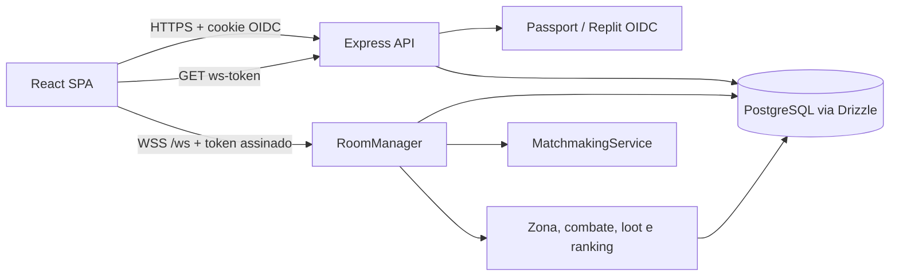

# Khaaos Run

**Khaaos Run** é um projeto de battle royale multiplayer para o Campo de Instrução de Guerra Khaaos Ville (CIGKV). O repositório reúne a aplicação web/API em execução, um runtime de jogo JavaScript isolado, algoritmos de matchmaking de referência em JavaScript/Python e uma fundação inicial em Unreal Engine 5.8.

Este README descreve o sistema tal como está implementado. Ele distingue comportamento validado, configuração de implantação e itens de roadmap; não trata protótipos locais como serviços de produção prontos.

## Sumário

- [Escopo e módulos](#escopo-e-módulos)
- [Arquitetura](#arquitetura)
- [Fluxo de uma partida](#fluxo-de-uma-partida)
- [Modelo de dados](#modelo-de-dados)
- [Autenticação e limites de confiança](#autenticação-e-limites-de-confiança)
- [API e WebSocket](#api-e-websocket)
- [Desenvolvimento local](#desenvolvimento-local)
- [Qualidade e validação](#qualidade-e-validação)
- [Build e implantação](#build-e-implantação)
- [Limitações conhecidas](#limitações-conhecidas)
- [Roadmap](docs/ROADMAP.md)
- [Análise Lighthouse](docs/LIGHTHOUSE_PERFORMANCE.md)

## Escopo e módulos

| Caminho | Responsabilidade | Ferramentas principais |
|---|---|---|
| `client/` | Interface React, telas, hooks de dados e cliente WebSocket | React 18, TypeScript, Vite, Wouter, TanStack Query, Tailwind |
| `server/` | API HTTP, sessões OIDC, salas e simulação authoritative | Node.js, Express 5, `ws`, Passport, PostgreSQL |
| `shared/` | Schema Drizzle, tipos e contratos compartilhados cliente/servidor | Drizzle ORM, Zod |
| `game-runtime/` | Runtime JavaScript separado para simulação, replay e testes de infraestrutura | Node.js, Vite, `node:test` |
| `Unreal/KhaaosRun/` | Projeto UE5.8 e headers C++ iniciais para gameplay/server authoritative | Unreal Engine 5.8, C++20, GAS/Iris/EOS declarados |
| `server/game/matchmaking-algorithm.js` | Implementação de referência do algoritmo skill-based queue | JavaScript puro |
| `server/game/matchmaking_algorithm.py` | Implementação de referência em Python para comparação/experimentos | Python 3 |
| `tests/official/` | Testes da aplicação web/API principal | `node:test`, `tsx` |
| `docs/` | Fluxos, segurança, cobertura, CI e roadmap | Markdown |

O `game-runtime/` não substitui `server/game/RoomManager.ts` nem é o servidor de produção da aplicação web. `Unreal/` é uma base inicial de portabilidade arquitetural: headers/configuração foram adicionados, mas não há evidência de que o projeto UE5 compile, contenha assets/mapas jogáveis ou esteja conectado a EOS. Seus testes e artefatos são distintos dos testes React/Express/Drizzle.

## Arquitetura



### Aplicação web

`client/src/App.tsx` registra as rotas Wouter. As telas são importadas com `React.lazy`, de modo que o navegador baixa o chunk da página acessada em vez de empacotar todas as telas no JavaScript inicial. O shell, o provedor de sessão de batalha, os modais globais e os componentes compartilhados ficam no carregamento comum.

TanStack Query concentra leitura e invalidação de dados HTTP. Os hooks por domínio ficam em `client/src/hooks/`; `client/src/lib/queryClient.ts` define `credentials: include` e o comportamento comum de erros.

### API e domínio

`server/index.ts` monta JSON/URL-encoded parsing, logging HTTP, rotas, WebSocket e o servidor de desenvolvimento/arquivos estáticos. `server/routes.ts` agrupa os handlers HTTP. `server/storage.ts` implementa a fronteira de persistência `IStorage` sobre Drizzle; `shared/schema.ts` é a fonte do schema PostgreSQL e dos tipos de domínio.

Os módulos de jogo têm responsabilidades delimitadas:

- `RoomManager.ts`: ciclo de vida de lobby/partida, jogadores conectados, zone ticks, combate, loot, mensagens e snapshots.
- `MatchmakingService.ts`: fila por modo e rating, janela de rating progressiva, agrupamento regional e eventos de matchmaking.
- `RankingService.ts`: cálculo de placement, rating/ELO, XP e promoção de patente após a partida.
- `LagCompensation.ts`: histórico de posições e compensação temporal de ataques.
- `SpatialGrid.ts`: consulta espacial para reduzir entidades e atualizações relevantes.
- `ProceduralGenerator.ts`: conteúdo determinístico por seed, mapas e loot.
- `EconomyEngine.ts` e `MonteCarloEconomy.ts`: cotações, regras de economia e simulações.

### Runtime isolado

`game-runtime/` conserva uma implementação JS com autenticação própria de testes, simulação reproduzível, snapshots, replay, persistência e adapters. As duas implementações têm escopos e contratos distintos; mudanças de regra devem declarar qual runtime é a fonte de verdade antes de sincronizar comportamento entre elas.

### Fundação Unreal Engine 5.8

`Unreal/KhaaosRun/KhaaosRun.uproject` declara Engine Association 5.8. O commit de fundação adicionou estruturas C++ para GameMode/GameState, estado do jogador, atributos/GAS, projétil, zona, loot, grade espacial, bridge econômico, AI controller e SaveGame. [`Unreal/README.md`](Unreal/README.md) descreve o mapeamento pretendido da implementação TypeScript para C++.

Esses artefatos são ponto de partida, não prova de build ou execução. Não há conteúdo de mapas/personagens, implementação EOS completa, testes Unreal/Automation nem validação em UnrealBuildTool registrada no CI atual. Mantenha o backend TypeScript como implementação comprovada e trate o port UE como trilha de desenvolvimento até que compile, tenha testes e passe validação multiplayer. Veja a seção Unreal do roadmap.

## Fluxo de uma partida

O caminho ranqueado principal está descrito em [`docs/E2E_BATTLE_FLOW.md`](docs/E2E_BATTLE_FLOW.md):

1. O usuário autentica via OIDC e a aplicação inicializa estatísticas e conta bancária quando necessário.
2. O cliente obtém uma credencial WebSocket curta por `GET /api/auth/ws-token`.
3. O `BattleRoomProvider` mantém uma conexão WebSocket compartilhada; o token é apresentado como subprotocolo durante o handshake.
4. O cliente entra na fila com `queue`; o servidor escolhe jogadores compatíveis por modo/rating e cria um lobby.
5. O lobby controla host, readiness, convite privado e countdown. O host pode iniciar ou cancelar de acordo com o estado da sala.
6. Em partida, o cliente envia intenções — posição, ataque, coleta ou ações de lobby — e não estado autoritativo de saúde, dano, loot ou identidade.
7. `RoomManager` valida e processa ações, atualiza o estado no servidor e envia mensagens/snapshots. A zona, o combate e a eliminação são calculados no servidor.
8. Ao concluir, `RankingService` persiste resultados/rating/XP e o cliente apresenta o resultado, atualiza ranking e histórico.

A simulação da zona legada também possui rotas HTTP e polling, fora de uma partida live. As rotas globais de ativação/desativação são restritas a operadores por allowlist; a partida live usa o estado gerido pela sala.

## Modelo de dados

As tabelas são declaradas em `shared/schema.ts` e configuradas para PostgreSQL em `drizzle.config.ts`.

- `users`: identidade OIDC, gerenciada pelo adapter de autenticação.
- `player_stats`: patente, XP, saúde/energia, eliminações e estatísticas competitivas.
- `bank_accounts`, `transactions` e `loans`: saldos, ledger de transações e obrigações da economia de jogo.
- `items`: inventário do usuário, tipo, raridade, durabilidade e stats JSON.
- `zone_sessions` e `loot_items`: estado de zona e pickups disponíveis/consumidos.
- `eliminations`: eventos de eliminação e causa.
- `match_results`: placement, kills, dano, sobrevivência, rating antes/depois e XP por jogador.

Os valores financeiros do jogo usam `numeric` no PostgreSQL e são convertidos para números em alguns handlers. Antes de usar valores de dinheiro real ou uma carteira, será necessário rever precisão decimal, atomicidade, ledger imutável, idempotência e compliance. O sistema atual é uma economia de jogo, não um sistema financeiro.

O comando atual `npm run db:push` aplica o schema via Drizzle Kit. Ele não equivale a um fluxo revisado de migrações versionadas; veja o roadmap antes de tratar deploy de schema como operação sem risco.

## Autenticação e limites de confiança

### Sessão HTTP

O login OIDC é registrado por `server/replit_integrations/auth/replitAuth.ts`. A sessão usa cookie `httpOnly`, `secure` e store PostgreSQL. `GET /api/auth/user` devolve o usuário autenticado; `isAuthenticated` valida/renova tokens OIDC para esse fluxo.

### WebSocket

`GET /api/auth/ws-token` exige sessão válida e emite um token HMAC-SHA256 com finalidade `khaaos-websocket` e validade de 60 segundos. O cliente o envia no cabeçalho `Sec-WebSocket-Protocol`, junto a `khaaos-v1`. `RoomManager` verifica assinatura, finalidade e expiração no handshake e deriva o `userId` exclusivamente do `sub` assinado. Mensagens do cliente não podem estabelecer nem substituir essa identidade.

O token curto autentica o handshake; não implementa revogação de conexões ativas. Os tokens não devem ser colocados em URLs ou logs.

### Controles administrativos

As rotas de iniciar/parar a zona e a interface consultam a permissão em `/api/zone/permissions`. O servidor autoriza apenas IDs incluídos em `ZONE_OPERATOR_IDS`; sem allowlist, nega por padrão. A validação no cliente é apenas UX, não fronteira de segurança.

Operações de item/empréstimo fazem lookup escopado ao proprietário autenticado antes de atualizar ou cobrar recursos. Outros endpoints devem manter o mesmo padrão: identidade obtida da sessão/token validado, autorização verificada no servidor, entrada limitada por schema e falha sem mutação parcial.

## API e WebSocket

Todos os caminhos HTTP protegidos usam cookie de sessão OIDC, salvo login/callback. A lista exata está nos handlers de `server/routes.ts` e `server/replit_integrations/auth/routes.ts`.

| Grupo | Exemplos | Propósito |
|---|---|---|
| Auth | `GET /api/auth/user`, `GET /api/auth/ws-token` | Usuário atual e token WS temporário |
| Player | `GET /api/player/me`, `POST /api/player/daily`, `POST /api/player/respawn` | Perfil e estado do jogador |
| Bank/loans | `/api/bank/*`, `/api/loans/*` | Saldos, transferências, ledger e empréstimos |
| Inventory/loot | `/api/items/*`, `/api/loot/*` | Inventário, uso, reparo e pickup |
| Zone | `/api/zone/status`, `/api/zone/start`, `/api/zone/stop` | Estado e operação autorizada da zona |
| Rooms/matchmaking | `/api/rooms/*`, `/api/matchmaking/*`, WS `/ws` | Estado público da sala e sessão multiplayer |
| Ranking | `/api/ranking/me`, `/api/ranking/history`, `/api/ranking/leaderboard` | Rating, histórico e leaderboard |
| Design/diagnostics | `/api/procgen/*`, `/api/economy/*`, `/api/eliminations` | Prévia procedural, cotações e métricas de jogo |

O protocolo WebSocket é JSON com discriminador `type`. Mensagens de cliente incluem `join`, `queue`, `dequeue`, `position`, `attack`, `pickup`, `leave`, `set_ready`, `start`, `create_lobby`, `join_code`, `kick` e `cancel_countdown`. Mensagens de servidor incluem `welcome`, `room_state`, `zone_tick`, `interest_update`, `match_found`, `countdown`, `damage_dealt`, `loot_picked`, `player_eliminated`, `match_finished`, `queue_update` e `error`.

O `ClientMessage` e os tipos `ServerMessage`/estado serializado em `server/game/RoomManager.ts`, junto de `client/src/hooks/use-battle-room.ts`, são o contrato vivo. Mudanças de protocolo devem atualizar os dois lados e adicionar um teste de integração.

## Desenvolvimento local

### Pré-requisitos

- Node.js 22 e npm 10+ para a aplicação principal.
- PostgreSQL para execução autenticada e persistência.
- Credenciais OIDC/Replit para testar login real.
- Python 3 somente para executar os algoritmos de referência Python.

### Instalação e comandos

```bash
npm ci
npm ci --prefix game-runtime
npm run check
npm run dev
```

`npm run dev` inicia o servidor Express/Vite em desenvolvimento na porta `PORT` ou 5000. O backend exige `DATABASE_URL`; a autenticação requer `SESSION_SECRET` e `REPL_ID`, além de issuer OIDC se não for o padrão. O login real também depende de callback OIDC e domínio corretamente configurados. Nunca inclua credenciais reais em commits.

Comandos comuns:

```bash
npm run check          # TypeScript da aplicação principal
npm run test:official  # testes Node/TS da aplicação e testes JS oficiais
npm run test:game      # testes do runtime isolado
npm run test:game:infra
npm run test:game:stress
npm run build          # client + server para dist/
npm start              # executar dist/index.cjs em produção
npm run db:push        # sincronizar schema Drizzle com DATABASE_URL
npm run verify:all     # typecheck/build/teste/stress de ambos os projetos
```

### Variáveis de ambiente

| Variável | Necessidade | Uso |
|---|---|---|
| `DATABASE_URL` | Obrigatória | PostgreSQL para usuário, sessões e domínio |
| `SESSION_SECRET` | Obrigatória para sessão | Assina cookies de sessão; use valor aleatório forte (mínimo recomendado: 32 bytes) |
| `REPL_ID` | Obrigatória para OIDC Replit | Client ID usado na discovery e nos callbacks |
| `ISSUER_URL` | Opcional | Issuer OIDC; padrão configurado no código é `https://replit.com/oidc` |
| `WS_TOKEN_SECRET` | Recomendado | Segredo HMAC do token WS; fallback para `SESSION_SECRET`; mínimo 32 bytes |
| `ZONE_OPERATOR_IDS` | Opcional, deny-by-default | IDs OIDC separados por vírgula para iniciar/parar a zona global |
| `PORT` | Opcional | Porta HTTP; padrão 5000, host `0.0.0.0` |
| `NODE_ENV` | Ambiente | `development` ativa Vite; `production` serve `dist/public` |

Gere segredos em um gerenciador seguro; por exemplo, `openssl rand -hex 32` gera 32 bytes aleatórios codificados em hexadecimal. Em implantação, use o Secret Store do host, não o repositório, logs ou frontend.

## Qualidade e validação

O workflow [`.github/workflows/ci.yml`](.github/workflows/ci.yml) executa `npm run verify:all` em pushes para `main` e pull requests para `main`. O script `scripts/verify-all.mjs` executa em paralelo:

1. `tsc` e build da aplicação principal.
2. Testes oficiais HTTP/auth/storage/WebSocket/matchmaking e validação de caminho core end-to-end.
3. Build, testes e stress tests do `game-runtime/`.
4. O CI atual não invoca UnrealBuildTool nem compila o projeto UE5.8.

Na validação após as integrações E2E de core, economia/procgen e spatial/lag, passaram 11 testes TypeScript oficiais, 38 testes JavaScript, 12 testes do runtime e 1 teste de stress. O estado pode crescer após novas alterações; execute os comandos do CI em vez de depender desses números fixos.

Não há percentual de cobertura instrumentado configurado. Portanto, número de testes aprovados não deve ser interpretado como percentual de statements, branches ou functions. O inventário e as lacunas estão em [`docs/TEST_COVERAGE_BASELINE.md`](docs/TEST_COVERAGE_BASELINE.md).

## Build e implantação

A configuração `.replit` declara **Autoscale**, executa `npm run build` e inicia `node ./dist/index.cjs`. O build emite a SPA em `dist/public/` e o servidor em `dist/index.cjs`; o servidor serve ambos na mesma porta.

Para uma implantação manual em Replit Autoscale:

1. Provisionar PostgreSQL e preparar schema no ambiente correto.
2. Definir `DATABASE_URL`, `SESSION_SECRET`, `WS_TOKEN_SECRET`, `REPL_ID` e os IDs operacionais em `ZONE_OPERATOR_IDS` nos Secrets do Replit.
3. Confirmar callback OIDC, domínio, HTTPS e portas.
4. Executar `npm run verify:all`, depois `npm run build`.
5. Publicar pela configuração de Autoscale e verificar login, `/api/auth/user`, emissão do token WS, matchmaking, partida e persistência do resultado.

Além do deployment Replit existente, o repositório agora contém configuração para um Web Service no Render. O GitHub Actions valida o push para `main`, chama o Render Deploy Hook com o SHA verificado e espera `/healthz.json` reportar aquele SHA. O job fica opt-in até `RENDER_DEPLOY_ENABLED=true`; para ativar, crie/aplique o Blueprint `render.yaml`, configure o secret `RENDER_DEPLOY_HOOK_URL` e as variables `RENDER_SERVICE_URL` e `RENDER_DEPLOY_ENABLED` conforme [`docs/RENDER_DEPLOYMENT.md`](docs/RENDER_DEPLOYMENT.md). Até então, CI permanece ativo sem tentar publicar.

**Atenção:** a documentação do Replit Auth garante suporte para apps em Replit e domínios customizados anexados a Published Apps Replit; ela não afirma suporte a hospedagem externa em Render. O código gera callback usando o hostname da requisição, mas isso não prova que o issuer Replit autorizará o domínio `onrender.com`. Valide login/callback/logout no domínio Render antes de transferir usuários ou tráfego real. Se o issuer rejeitar o domínio, mantenha o serviço no Replit ou planeje uma migração de identidade revisada; não contorne validação de redirect.

## Limitações conhecidas

- Storage da aplicação principal é PostgreSQL, mas algumas operações econômicas ainda fazem leitura e escrita em chamadas separadas, sem uma transação atômica de ledger. Evite concorrência financeira real.
- O schema está configurado para Drizzle `db:push`; migrações versionadas, rollout/rollback e compatibilidade entre versões ainda precisam de desenho.
- `RoomManager` e matchmaking têm estado ativo em memória. Escalar horizontalmente requer coordenador, presença compartilhada, pub/sub e ownership explícito de salas.
- Existe um runtime de jogo isolado com primitivas adicionais; não presumir paridade automática com o servidor Express.
- Não há suite browser completa para React, teste OIDC com provider real ou coverage percentual.
- Produção requer monitoramento de latência/jitter, rate limits, reconexões, erros de autenticação e integridade de ranking.
- Antes de economia com valor real, são necessários revisão legal/compliance, segurança, prevenção de fraude e controles de auditoria. A moeda KRC atual é de jogo.

## Referências de desenvolvimento

- [Fluxo end-to-end de batalha](docs/E2E_BATTLE_FLOW.md)
- [Autenticação realtime e controles da zona](docs/REALTIME_AUTH.md)
- [Baseline e lacunas da cobertura](docs/TEST_COVERAGE_BASELINE.md)
- [Comparação Lighthouse antes/depois do code splitting](docs/LIGHTHOUSE_PERFORMANCE.md)
- [Setup de deploy Render pós-CI](docs/RENDER_DEPLOYMENT.md)
- [Roadmap de engenharia](docs/ROADMAP.md)
- [Fundação Unreal Engine 5.8](Unreal/README.md)
- [Plano do runtime isolado](game-runtime/plan.md)
