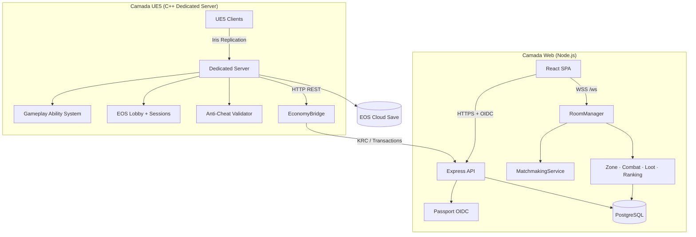

# Khaaos Run

**Um Jogo · Uma Chance · Um Legado**

> Plataforma Battle Royale multi-mundo com recompensa real de **US$ 1.000.000**.
> O jogador se alista voluntariamente, assume o posto de **Zheers** e atravessa uma sequência de *Rings* (mundos) que funcionam como filtros psicológicos, táticos e econômicos progressivos.

> **Nível Devs Ph.D** — 20+ PRs merged · 162 arquivos C++ · 25.000+ linhas UE5 · 8 workflows CI/CD · IaC Terraform · Fase 0-5 End-to-End

---

## Sumário

- [Status do Projeto](#status-do-projeto)
- [Ontologia dos Mundos](#ontologia-dos-mundos)
- [Arquitetura de Ciclos e Rings](#arquitetura-de-ciclos-e-rings)
- [Protocolo CIGKV — Campo de Treinamento](#protocolo-cigkv--campo-de-treinamento)
- [Mundos Oficiais (W1–W4)](#mundos-oficiais-w1w4)
- [Protocolos de Ingresso (Zu)](#protocolos-de-ingresso-zu)
- [Modelo Econômico e Persistência](#modelo-econômico-e-persistência)
- [Arquitetura Técnica — Devs Ph.D](#arquitetura-técnica--devs-phd)
- [Inventário de Sistemas UE5](#inventário-de-sistemas-ue5)
- [CI/CD e Automação](#cicd-e-automação)
- [Infraestrutura de Produção](#infraestrutura-de-produção)
- [Fluxo de uma Partida](#fluxo-de-uma-partida)
- [Modelo de Dados](#modelo-de-dados)
- [Autenticação e Limites de Confiança](#autenticação-e-limites-de-confiança)
- [API e WebSocket](#api-e-websocket)
- [Desenvolvimento Local](#desenvolvimento-local)
- [Qualidade e Validação](#qualidade-e-validação)
- [Build e Implantação](#build-e-implantação)
- [Limitações Conhecidas](#limitações-conhecidas)
- [Roadmap Go Live](#roadmap-go-live)
- [Referências](#referências)

---

## Status do Projeto

| Dimensão | Estado | Detalhe |
|----------|--------|---------|
| **Web/API (TS/Node)** | ✅ Produção | Express 5, React 18, WebSocket, Economy, Matchmaking |
| **UE5 C++ Core** | ✅ Implementado | 27 subsistemas, 162 arquivos, 25.000+ linhas |
| **Gameplay Ability System** | ✅ Implementado | 11 abilities, GameplayEffects, Tags, Enhanced Input |
| **Rede / Replicação** | ✅ Implementado | Iris, Relevancy, NetMetrics, Spatial Grid |
| **EOS (Epic Online Services)** | ✅ Produção | Auth, Lobby, Matchmaking, Sessions, Cloud Save (LZ4/SHA256), 3 regiões |
| **CI/CD** | ✅ Operacional | 8 workflows (ci, ue5-build, eos, economy, deploy, stress-test, release, pr-checks) |
| **Docker / Dedicated Server** | ✅ Produção | Multi-stage Dockerfile, docker-compose (8 services, 3 networks) |
| **Anti-Cheat** | ✅ Produção | Movement validation, 3-strike auto-kick, EAC SDK integration (client/server) |
| **Economia (KRC)** | ✅ Produção | AtomicLedger (15 tx types, SHA256 chain, escrow), Compliance (KYC/AML/BCB/IRPF) |
| **Mundos W1-W4** | ✅ Implementado | Barburhen (100p, seasons), Priadus (75p, aquatic), Ckesalth (60p, altitude), Arukheea (80p, desert) |
| **Load Testing** | ✅ Produção | 4 profiles (100-2000 bots), 3 ramp strategies, Prometheus integration |
| **Beta → Go Live** | ✅ Implementado | BetaCampaign (6 phases, NDA, EXCO 1M), StreamingIntegration (OBS/Twitch/YouTube) |
| **Infraestrutura (IaC)** | ✅ Implementado | Terraform (3 regiões, ECS, RDS, Redis), Cloudflare DNS/CDN/WAF, Prometheus + Grafana |
| **Launch Readiness** | ✅ Produção | Rate limiting, DDoS protection, 30+ point go-live checklist, monitoring stack |
| **Build UE5 (compilação)** | ⏳ Pendente | Requer UE5.8 Editor + 50 GB+ SDK para compilar |
| **3D Assets / Mapas** | ⏳ Pendente | Lógica + dados CIGKV/W1-W4 completos; `.umap`, meshes e Niagara precisam ser criados no UE Editor |
| **EAC SDK Binary** | ⏳ Pendente | Easy Anti-Cheat requer SDK binary + build compilado |

---

## Ontologia dos Mundos

O console **não possui um único mundo**. A Guerra do Khaaos é uma sequência de *Rings* (ambientes de batalha) organizados em estágios de intensidade crescente. Cada Ring é, simultaneamente:

1. **Campo de combate** (mecânicas, loot, zona, eliminação);
2. **Filtro psicológico** (melancolia, paranoia, asfixia, isolamento);
3. **Instrumento de coleta de dados** (balanceamento, taxa de retenção, padrões de risco);
4. **Mecanismo de persistência seletiva** (conquistas, Tokens de Veterano, KRC).

| Estágio | Identificador | Nome Canônico | Função Primária | Duração-alvo |
|---------|---------------|---------------|-----------------|--------------|
| Pré-lançamento | **CIGKV** | Khaaos Ville — Campo de Instrução de Guerra | Treinamento, coleta de dados, campanha de massa | Até 1.000.000 de alistamentos |
| Ciclo 1 | **W1/C1** | Barburhen — Mundo da Destruição | Brutalidade urbana pós-guerra | 7 dias (12 h/dia) |
| Ciclo 2 | **W2/C2** | Priadus — Floresta da Escuridão | Sanidade sob invisibilidade e neblina | 7 dias |
| Ciclo 3 | **W3/C3** | Ckesalth — Deserto das Almas Esquecidas | Fragilidade da vaidade / ambiente em extinção | 7 dias |
| Ciclo 4 | **W4/C4** | Arukheea — Ilha dos Gritos Calados | Isolamento absoluto e pressão hidráulica | 7 dias |

O desenho segue a doutrina do **Descentralizador**: cada mundo remove uma dimensão de segurança (tecnologia → estômago → sanidade → vaidade → refúgio) até restar apenas o sobrevivente capaz de ocupar o helicóptero de extração final.

---

## Arquitetura de Ciclos e Rings

```
┌─────────────────────────────────────────────────────────────────┐
│                    GUERRA DO KHAAOS (Ciclos)                    │
├──────────────┬──────────────┬──────────────┬────────────────────┤
│   CIGKV      │   W1/C1      │   W2/C2      │  W3/C3 → W4/C4     │
│  (Treinamento│  Barburhen   │  Priadus     │  Ckesalth →        │
│   + Campanha)│  (Urbano)    │  (Selva)     │  Arukheea (Ilha)   │
└──────────────┴──────────────┴──────────────┴────────────────────┘
         │              │              │              │
         ▼              ▼              ▼              ▼
   Protocolo CIGKV   Anel de       Emboscada      Tsunami /
   Ring 3 h          Conflito      Verde          Assassino
   50 players        10 min        10 min         Silencioso
   Fluxo contínuo    Zona →        Zona →         Zona →
                     Parque        Templo         Prisão
```

Cada Ring possui:

- **Perímetros fracionados** (frações de ⅛ a ⅜ do mapa) com funções táticas distintas;
- **Plus +** (vantagens posicionais: bunkers, sniper points, veículos, kits médicos);
- **Plus −** (perigos ambientais: chuva ácida, neblina alucinógena, areia movediça, flora carnívora, tsunami);
- **Zonas de Extração de XP (ZEX)** — terminais que permitem persistir parte das conquistas;
- **Dinâmica de inatividade** — "dedo-duro" (ratos, mosquitos, gafanhotos, gaivotas) que pune o jogador que evita combate.

---

## Protocolo CIGKV — Campo de Treinamento

O **CIGKV** (Campo de Instrução de Guerra Khaaos Ville) é o *spoiler experimental* aberto após o alistamento. Ele permanece ativo até a marca de **1.000.000 de inscrições confirmadas** (sigla **EXCO** — Excesso e Contingente).

### Ambientes (perímetro total = 1)

| Setor | Fração | Função |
|-------|--------|--------|
| Pátio de Armamento (Armory Hub) | ⅛ | Zona neutra de loadout sem restrição de patente |
| Setor de Testes (Proving Grounds) | ⅜ | Urbano denso, prédios destrutíveis, túneis |
| Parque Abandonado | ⁴⁄₈ | Vegetação, riachos, emboscadas |
| 15 Zonas de Extração de XP (ZEX) | dispersas | Persistência seletiva de conquistas |

### Dinâmica de Ring

- **Capacidade**: 50 jogadores.
- **Duração**: 3 horas (Ring de Longa Duração).
- **Entrada em fluxo contínuo**: vaga aberta instantaneamente ao sair/eliminar; bloqueio nos últimos 5 minutos.
- **Pulso Khaaos**: a cada 10 minutos, alteração climática ou drop de loot lendário.
- **Arsenal sem limites de patente**: Recruta pode testar equipamento de nível General — objetivo é coleta de dados de balanceamento.

### Desafio de Gigantes (pós-EXCO)

Os 50 melhores do CIGKV são convocados para a "Guerra dos Filhos da Escuridão" (batalha noturna, transmissão YouTube). Recebem:

- Insígnia **Mérito KR**;
- **Código KR-N1** (manual de instrução);
- 1000 KRC + kits;
- **Token de Veterano** conversível em pack diferenciado no W1/C1 oficial.

Os 1000 melhores pontuados do período experimental recebem persistência parcial de itens/KRC/medalhas/skins.

---

## Mundos Oficiais (W1–W4)

### W1/C1 — Barburhen (Mundo da Destruição)

Ambiente urbano pós-guerra: construções inacabadas, carros abandonados, corpos que **não desaparecem** e apodrecem. O cenário degrada dia após dia (chuva ácida, desabamentos, fumaça).

| Setor | Fração |
|-------|--------|
| Área Urbana e Comercial | ²⁄₈ |
| Setor Industrial (desembarque) | ⅜ |
| Parque Abandonado (centro) | ⅜ |
| Zona de Extração (estação ferroviária) | — |

**Dinâmica**: "Água da Morte" — anel de conflito fecha em 10 min em direção ao Parque; quem não corre é consumido pela chuva ácida.

### W2/C2 — Priadus (Floresta da Escuridão)

Selva hostil, neblina alucinógena, pântanos, flora carnívora, jacarés. Teste de sanidade mental diante do invisível.

| Setor | Fração |
|-------|--------|
| Área Pantanosa | ²⁄₈ |
| Bosque (desembarque) | ⅜ |
| Área de Caça + Templo Antigo | ⅜ |
| Zona de Extração (matadouro) | — |

**Dinâmica**: "Emboscada Verde" — anel fecha no templo; neblina com esporos tóxicos pune atraso.

### W3/C3 — Ckesalth (Deserto das Almas Esquecidas)

Deserto árido, lagoas de petróleo em chamas, fumaça tóxica, areia movediça. Lição sobre a fragilidade da vaidade.

| Setor | Fração |
|-------|--------|
| Resort Abandonado | ⅜ |
| Vilarejo dos Beduínos | ²⁄₈ |
| Refinaria de Petróleo (centro) | ⅜ |
| Zona de Extração (expedição) | — |

**Dinâmica**: "Assassino Silencioso" — a partir de 5 min o anel fecha na Vila Sombria sob fumaça tóxica.

### W4/C4 — Arukheea (Ilha dos Gritos Calados)

Ilha isolada, Prisão do Sol da Noite (luz perpétua), tsunami iminente, tubarões. Pressão hidráulica e claustrofobia em céu aberto.

| Setor | Fração |
|-------|--------|
| Bosque dos Perdidos | ⁴⁄₈ |
| Prisão do Sol da Noite | ⅜ |
| Fábrica / Cemitério das Baleias | ⅛ |
| Extração final (heliporto da torre) | — |

**Dinâmica**: "Tsunami" — anel fecha na Prisão; quem não sobe no helicóptero torna-se "grito calado".

---

## Protocolos de Ingresso (Zu)

Todo Ring possui **três variantes de Zu** (entrada cinematográfica). O jogador recebe um pop-up de decisão que determina dano inicial e posicionamento.

| Mundo | Zu 1 | Zu 2 | Zu 3 |
|-------|------|------|------|
| **CIGKV** | Caminhão atropela bois → apertar cinto | Capota com rocha → saltar | Cai da ponte → máscara O₂ |
| **W1/C1** | Trem descarrila → cinto | Colisão frontal → saltar | Incêndio elétrico → máscara |
| **W2/C2** | Fim de trilho → cinto | Homens-bomba → saltar | Neblina tóxica → máscara |
| **W3/C3** | Tempestade de areia → cinto | Explosão no túnel → saltar | Caminhão-tanque em chamas → máscara |
| **W4/C4** | Trilho desmorona → cinto | Colisão com tanque → saltar no mar | Bombas de gás por drones → máscara |

Em todos os casos:

- Decisão correta → 0 dano + possível atordoamento/visão embaçada (5–7 s);
- Decisão incorreta → até −30 % de vitalidade;
- Caixotes de armamento caem no perímetro (1 item por jogador).

---

## Modelo Econômico e Persistência

- **KRC** (Khaaos Run Coin) — criptomoeda de jogo. Adquirida por sobrevivência, eliminações, captura de Data Cores e ranking de convites.
- **Bankhaoos** — conta bancária automática ao alistamento + endereço de depósito.
- **Fundo de Investimentos KR** — acumula o prêmio de US$ 1.000.000 destinado ao(à) grande vencedor(a).
- **Forja do Armeiro** — marketplace de equipamentos e upgrades pagos em KRC.
- **Persistência seletiva**: conquistas do CIGKV não migram integralmente; apenas Tokens de Veterano, packs e os 1000 melhores pontuados recebem transferência parcial para W1/C1.
- **Zonas de extração de XP**: terminais no mapa que "salvam" progresso para o inventário War'I, desde que o jogador não seja eliminado antes.

> **Atenção de engenharia**: a economia atual é de jogo. Antes de qualquer valor real, são obrigatórios ledger imutável, atomicidade, idempotência, prevenção de fraude e revisão de compliance.

---

## Arquitetura Técnica — Devs Ph.D

### Visão Geral de Duas Camadas

O Khaaos Run opera em duas camadas complementares que se comunicam via HTTP REST e shared database:

```
┌───────────────────────────────────────────────────────────────────────────┐
│                         CAMADA WEB (Node.js)                             │
│  ┌──────────┐  ┌──────────┐  ┌──────────┐  ┌──────────────────────────┐  │
│  │ React SPA │  │ Express 5│  │ WebSocket│  │ Economy Microservice    │  │
│  │ Vite+TS   │  │ API/REST │  │ RoomMgr  │  │ MonteCarlo / SpatialGrid│  │
│  └──────────┘  └──────────┘  └──────────┘  └──────────────────────────┘  │
│         │            │             │                    │                  │
│         └────────────┴─────────────┴────────────────────┘                 │
│                              │  PostgreSQL (Drizzle)                      │
└──────────────────────────────┼───────────────────────────────────────────┘
                               │
┌──────────────────────────────┼───────────────────────────────────────────┐
│                    CAMADA UE5 (C++ Dedicated Server)                      │
│  ┌──────────┐  ┌──────────┐  ┌──────────┐  ┌──────────────────────────┐  │
│  │ GameMode  │  │ GAS      │  │ Iris Net │  │ EOS (Auth/Lobby/Session) │  │
│  │ 100p BR  │  │ Abilities│  │ Relevancy│  │ Cloud Save / Matchmaking │  │
│  └──────────┘  └──────────┘  └──────────┘  └──────────────────────────┘  │
│  ┌──────────┐  ┌──────────┐  ┌──────────┐  ┌──────────────────────────┐  │
│  │ AntiCheat│  │ Pool+Sig │  │ HUD+Audio│  │ Production Config        │  │
│  │ 3-Strike │  │ Niagara  │  │ MetaSound│  │ RateLimit / DDoS / Mon   │  │
│  └──────────┘  └──────────┘  └──────────┘  └──────────────────────────┘  │
│                              │  EconomyBridge (HTTP → Node.js)            │
└──────────────────────────────┴───────────────────────────────────────────┘
```

### Mapa de Código

| Caminho | Responsabilidade | Stack |
|---------|------------------|-------|
| `client/` | SPA React, telas, hooks, cliente WebSocket | React 18, TypeScript, Vite, Wouter, TanStack Query, Tailwind |
| `server/` | API HTTP, sessões OIDC, salas, simulação authoritative | Node.js, Express 5, `ws`, Passport, PostgreSQL |
| `shared/` | Schema Drizzle, tipos e contratos | Drizzle ORM, Zod |
| `game-runtime/` | Runtime JS isolado (simulação, replay, testes) | Node.js, Vite, `node:test` |
| `Unreal/KhaaosRun/` | **UE5.8 C++ completo — 19 subsistemas, 16.165 linhas** | Unreal Engine 5.8, C++20, GAS, Iris, EOS, Lyra |
| `server/game/matchmaking-*.{js,py}` | Algoritmos de referência skill-based | JS / Python 3 |

### Diagrama de Fluxo



O `RoomManager` (Node.js) é a fonte de verdade da partida live na camada web. O `KhaaosGameMode` (C++) é a fonte de verdade na camada UE5. A `EconomyBridge` conecta as duas camadas, delegando transações KRC ao microsserviço Node.js.

---

## Inventário de Sistemas UE5

Todos os sistemas abaixo estão implementados em C++20 no diretório `Unreal/KhaaosRun/Source/KhaaosRun/Game/`:

### 1. Game Core

| Sistema | Arquivos | Linhas | Descrição |
|---------|----------|--------|-----------|
| **KhaaosGameMode** | .h + .cpp | 510 | GameMode BR 100p, zone shrinking, elimination, win condition |
| **KhaaosGameState** | .h + .cpp | 123 | Estado replicado da partida (phase, zone, alive count) |
| **KhaaosPlayerState** | .h + .cpp | 237 | Stats do jogador (kills, damage, KRC, rank, sequela) |
| **KhaaosAttributeSet** | .h + .cpp | 148 | GAS attributes: Health, Shield, Energy, Stamina, Speed |

### 2. Combat & Abilities (GAS)

| Sistema | Arquivos | Linhas | Descrição |
|---------|----------|--------|-----------|
| **KhaaosAbilityComponent** | .h + .cpp | 232 | UAbilitySystemComponent wrapper com tag-based init |
| **KhaaosAbilitySet** | .h/.cpp | 228 | UPrimaryDataAsset com GiveAbilities/RemoveAbilities |
| **Movement Abilities** | 4 × .h/.cpp | 718 | Sprint, Jump, Slide, GrapplingHook — LocalPredicted |
| **Combat Abilities** | 5 × .h/.cpp | 803 | Shoot, Reload, Melee, Throw, Ultimate — ServerInitiated |
| **Defense Abilities** | 2 × .h/.cpp | 505 | Shield, Heal — ServerInitiated |
| **KhaaosProjectile** | .h + .cpp | 300 | Projectile replicado com pooled lifecycle |
| **KhaaosGameplayTags** | .h + .cpp | 416 | 60+ tags estáticas via FGameplayTag::RequestGameplayTag |
| **KhaaosGameplayEffects** | .h/.cpp | 795 | Factory: Cooldown, Cost, Buff, Debuff, HealOT, Damage, ZoneDamage |
| **KhaaosEffectApplier** | .h + .cpp | — | UGameInstanceSubsystem Apply/Remove/Query effects |

### 3. Input

| Sistema | Arquivos | Linhas | Descrição |
|---------|----------|--------|-----------|
| **KhaaosInputConfig** | .h + .cpp | 439 | UPrimaryDataAsset: Native + Ability Input Actions |
| **KhaaosInputComponent** | .h + .cpp | — | UEnhancedInputComponent (padrão Lyra) |
| **KhaaosInputTags** | .h + .cpp | — | 15 IA_ references (Move/Look/Jump/Sprint/Slide/Shoot/etc.) |

### 4. Network & Replication

| Sistema | Arquivos | Linhas | Descrição |
|---------|----------|--------|-----------|
| **KhaaosReplicationConfig** | .h + .cpp | 384 | Iris priorities, NetUpdateFrequency, push model |
| **KhaaosNetworkRelevancy** | .h + .cpp | 428 | Distance-based relevancy com hysteresis, dynamic throttling |
| **KhaaosNetMetrics** | .h + .cpp | 381 | RTT/loss/BW tracking, EMA smoothing, 150ms alert |
| **SpatialGrid** | .h + .cpp | 203 | Grid espacial para queries eficientes de proximidade |

### 5. EOS (Epic Online Services)

| Sistema | Arquivos | Linhas | Descrição |
|---------|----------|--------|-----------|
| **KhaaosEOSManager** | .h + .cpp | 1.517 | Platform init + Auth (Login/Logout), Product/Sandbox/Deploy IDs |
| **KhaaosEOSLobby** | — | — | CreateLobby/JoinLobby/LeaveLobby/PromoteMember |
| **KhaaosEOSMatchmaking** | — | — | StartMatchmaking/CancelMatchmaking (Pool/Region/Skill) |
| **KhaaosEOSSession** | — | — | HostDedicatedServer/JoinSession/DestroySession/RegisterServer |
| **KhaaosCloudSave** | .h/.cpp | 1.403 | CloudStorage upload/download/delete, auto-save 120s |
| **KhaaosSaveSync** | — | — | ComputeDiff, MergeSaves (4 strategies), auto-sync on login |

### 6. AI & Load Testing

| Sistema | Arquivos | Linhas | Descrição |
|---------|----------|--------|-----------|
| **KhaaosAIController** | .h + .cpp | 363 | AI bot controller para populate de partidas |
| **KhaaosLoadTestBot** | .h + .cpp | 887 | Bot com behavior profile, timed actions |
| **KhaaosLoadTestManager** | — | — | 100-bot wave spawning, metrics, JSON report |

### 7. World & VFX

| Sistema | Arquivos | Linhas | Descrição |
|---------|----------|--------|-----------|
| **KhaaosSafeZone** | .h + .cpp | 324 | Shrinking zone com damage, phase, timer |
| **KhaaosPCGConfig** | .h + .cpp | 434 | 5 biomes PCG rules, DataTable-driven |
| **KhaaosVFXManager** | .h + .cpp | 623 | Niagara VFX subsystem com SignificanceManager |
| **KhaaosZoneAudio** | — | — | Warning loop, damage tick, phase advance, distance intensity |

### 8. Pooling & Optimization

| Sistema | Arquivos | Linhas | Descrição |
|---------|----------|--------|-----------|
| **KhaaosActorPool** | .h + .cpp | 1.279 | GetPooledActor/ReturnToPool/WarmPool/DrainPool, max 500/class |
| **KhaaosSignificanceManager** | — | — | 5-level LOD (Critical→Insignificant), auto-disable tick |
| **KhaaosPooledProjectile** | — | — | Activate/Deactivate lifecycle, MaxLifetime, never Destroy |

### 9. Data & Blueprints

| Sistema | Arquivos | Linhas | Descrição |
|---------|----------|--------|-----------|
| **KhaaosDataTables** | .h + .cpp | 511 | 5 DataTables com typed accessors |
| **KhaaosBlueprintRegistry** | .h + .cpp | 326 | 27 TSoftClassPtr, async LoadAll() |
| **KhaaosSaveGame** | .h + .cpp | 192 | Save game structure local |

### 10. HUD & Audio

| Sistema | Arquivos | Linhas | Descrição |
|---------|----------|--------|-----------|
| **KhaaosHUD** | .h + .cpp | 1.107 | Widget orchestration, Show/Hide/Toggle scoreboard |
| **KhaaosHUDWidget** | — | — | UCommonActivatableWidget — bars, cooldowns, kill feed, crosshair |
| **KhaaosScoreboardWidget** | — | — | KDA entries, sort by Kills/Damage/Rank |
| **KhaaosMinimapWidget** | — | — | Player-centered, rotation, zone circle, WorldToMinimap |
| **KhaaosAudioManager** | .h/.cpp | 1.572 | 5 SoundClasses, 4 SoundMixes, Play3D/2D/Attached |
| **KhaaosAdaptiveMusic** | — | — | 7 states, intensity [0,1], crossfade, combat transitions |

### 11. Debug & Dev Tools

| Sistema | Arquivos | Linhas | Descrição |
|---------|----------|--------|-----------|
| **KhaaosGameplayDebugger** | .h + .cpp | 1.244 | 5 IGameplayDebuggerCategory — Abilities, Relevancy, Pool, Zone, Net |
| **KhaaosDebugCommands** | — | — | 8 console commands (khaaos.debug.*), god mode, infinite ammo |

### 12. Economy Bridge

| Sistema | Arquivos | Linhas | Descrição |
|---------|----------|--------|-----------|
| **EconomyBridge** | .h + .cpp | 428 | HTTP REST client para Node.js Economy microservice (KRC, Bank, Loans) |

### 13. Anti-Cheat

| Sistema | Arquivos | Linhas | Descrição |
|---------|----------|--------|-----------|
| **KhaaosAntiCheat** | .h + .cpp | 1.010 | ValidateMovement/Shot/Damage/ItemPickup, 3-strike auto-kick |
| **KhaaosMovementValidator** | — | — | Circular buffer 120 samples, speed/teleport/fly hack detection |

### 14. Loot

| Sistema | Arquivos | Linhas | Descrição |
|---------|----------|--------|-----------|
| **KhaaosLootPickup** | .h + .cpp | 148 | Loot pickup replicado com rarity, context-sensitive interaction |

### 15. Launch Readiness & Production

| Sistema | Arquivos | Linhas | Descrição |
|---------|----------|--------|-----------|
| **KhaaosServerConfig** | .h + .cpp | 932 | Server/Network/Performance config, CLI+INI overrides |
| **KhaaosProductionConfig** | .h + .cpp | 2.252 | Feature flags + production lockdown |
| **KhaaosRateLimiter** | — | — | 60/min + 10/s + burst 5, per-IP + per-player |
| **KhaaosDDoSProtection** | — | — | 50/s global, 5/IP, auto-block 30min |
| **KhaaosMonitorDashboard** | — | — | Server/Game/Security metrics, 5s collection |
| **KhaaosLaunchChecklist** | — | — | 14 pre-launch checks (8 Critical, 6 Warning) |

### Módulos UE5 no Build.cs

```
Public:  Core, CoreUObject, Engine, InputCore, EnhancedInput,
         GameplayAbilities, GameplayTags, GameplayTasks, Niagara,
         NavigationSystem, AIModule, StateTreeModule,
         SignificanceManager, Iris, NetCore,
         OnlineSubsystem, OnlineSubsystemUtils,
         ModularGameplay, ModularGameplayActors, CommonUI, UIExtension,
         OnlineServicesInterface

Private: GameFeatures, LyraGame, PCG, Metasound, AudioMixer,
         Chaos, PhysicsCore, EOSIntegrationKit

Editor:  UnrealEd, EditorFramework, KhaaosRunEditor
```

---

## CI/CD e Automação

### Workflows GitHub Actions

| Workflow | Arquivo | Trigger | Função |
|----------|---------|---------|--------|
| **CI** | `ci.yml` | Push/PR | Lint, typecheck, unit tests, game-runtime tests, Docker build, UE5 C++ validation, economy integrity, security scan |
| **UE5 Build** | `ue5-build.yml` | Push Source/Config | Validate .uproject, generate project files, build server target, package, Docker push |
| **EOS Integration** | `eos-integration.yml` | Push EOS/Save/AntiCheat | Validate EOS config (3 regions), C++ implementation audit, auth smoke test, region connectivity |
| **Economy Validation** | `economy-validation.yml` | Push Economy | Ledger integrity audit (15 tx types, SHA256, escrow), Compliance (KYC/AML/BCB/IRPF), bridge validation, world progression gates |
| **Deploy** | `deploy.yml` | Push main + manual | Pre-deploy validation, build Docker images, deploy staging (Render) / production (3 regions), health checks, notifications |
| **Stress Test** | `stress-test.yml` | Manual + weekly | 100/500/1000/2000 bot profiles, ramp-up strategies, region targeting, Prometheus push, JSON reporting |
| **Release** | `release.yml` | Tag v* + manual | Version + changelog, build all artifacts, Docker images (server + UE5), GitHub Release, notifications |
| **PR Checks** | `pr-checks.yml` | PR events | Auto-label by path, size classification, conventional commits validation, changed files summary |

### Automação de Push/PR

- **`scripts/khaaos_workflow.sh`** — automação completa: stage → commit → rebase main → push → create PR (draft/ready, com reviewers)
- **`scripts/khaaos_auto_push.sh`** — push simplificado para branch dedicada
- Opera **SEMPRE** em branch `feat/*`, **NUNCA** na `main`
- Rebase automático da `main` antes de cada push (sync com outros Devs)

### Labels Automáticas

Configuradas em `.github/labeler.yml`: `ue5`, `cpp`, `gameplay`, `economy`, `ai`, `client`, `ci-cd`, `tests`, `docs`

### Histórico de PRs

| PR | Branch | Status | Sistemas |
|----|--------|--------|----------|
| #1 | feat/e2e-hardening | MERGED | Matchmaking unit tests + import guard |
| #2 | feat/ue5-phd-foundation | MERGED | UE5.8 project structure + C++ headers |
| #3 | feat/e2e-core-validation | MERGED | Core path validation (match→lobby→ELO) |
| #4 | feat/pr4-lag-spatial-e2e | MERGED | Lag compensation + spatial grid e2e |
| #5 | feat/ue5-cicd-automation | MERGED | CI/CD pipelines, PR automation, dev coordination |
| #6 | feat/pr5-economy-procgen-e2e | MERGED | Economy price discovery + seeded procgen |
| #7 | feat/render-cicd | MERGED | Deploy verified commits to Render |
| #8 | feat/full-pipeline-e2e | MERGED | Full pipeline narrative (match→combat→rank→economy) |
| #9 | feat/ue5-cpp-implementations | MERGED | C++ implementations for all game systems |
| #10 | fix/ue5-server-docker | MERGED | Fix UE5 server Docker build |
| #11 | feat/ue5-assets-gameplaytags | MERGED | GameplayTags (60+), Niagara VFX, PCG, Blueprints, DataTables |
| #12 | feat/ue5-abilities-replication | MERGED | UGameplayAbility subclasses + Iris replication hardening |
| #13 | feat/ue5-ge-input-eos-pooling | MERGED | GameplayEffects, Enhanced Input, EOS Integration, Actor Pooling |
| #14 | feat/ue5-debugger-saveui-audio | MERGED | Gameplay Debugger, EOS Cloud Save, CommonUI HUD, MetaSound Audio |
| #15 | feat/ue5-server-load-anticheat-launch | MERGED | Dedicated Server, Load Test, Anti-Cheat, Launch Readiness |

---

## Infraestrutura de Produção

### Docker — Dedicated Server

```yaml
# docker-compose.yml
services:
  ue5-server:     # UE5.8 Linux dedicated (5GB runtime, non-root, healthcheck)
  economy-api:    # Node.js Economy microservice
  redis:          # Session cache + rate limiting
  prometheus:     # Metrics collection
  grafana:        # Monitoring dashboards
```

- **Dockerfile**: Multi-stage (50 GB builder → 5 GB runtime), non-root, healthcheck
- **docker-compose.yml**: Server + Economy API + Redis + Prometheus + Grafana
- **GHCR**: Imagens publicadas no GitHub Container Registry

### Segurança em Produção

| Camada | Implementação | Parâmetros |
|--------|---------------|-----------|
| **Rate Limiting** | KhaaosRateLimiter | 60/min, 10/s, burst 5 (per-IP + per-player) |
| **DDoS Protection** | KhaaosDDoSProtection | 50/s global, 5/IP, auto-block 30 min |
| **Anti-Cheat** | KhaaosAntiCheat + MovementValidator | 3-strike auto-kick, circular buffer 120 samples |
| **Network** | Iris + Relevancy + Metrics | Distance-based, hysteresis, 150 ms alert |
| **Authentication** | EOS Auth + HMAC WS tokens | OIDC sessions, signed subprotocol |
| **Monitoring** | KhaaosMonitorDashboard | Server/Game/Security metrics, 5 s collection |

### Launch Checklist (14 checks)

8 **Critical**: Server build, Anti-Cheat active, Rate Limiter, DDoS, EOS Auth, DB migrations, SSL/TLS, Healthcheck
6 **Warning**: Monitoring dashboard, Backup strategy, Log aggregation, CDN, Feature flags, Load test pass

---

## Fluxo de uma Partida

Documentado em detalhe em [`docs/E2E_BATTLE_FLOW.md`](docs/E2E_BATTLE_FLOW.md):

1. Autenticação OIDC → estatísticas e conta bancária inicializadas.
2. Cliente obtém token WebSocket de curta duração (`GET /api/auth/ws-token`).
3. `BattleRoomProvider` mantém conexão compartilhada; identidade derivada exclusivamente do token assinado.
4. Entrada na fila (`queue`) → matchmaking por modo/rating → lobby.
5. Host controla readiness, convites e countdown.
6. Em partida o cliente envia **intenções** (posição, ataque, pickup); o servidor é authoritative para saúde, dano, loot e eliminação.
7. Zone ticks, combate, lag compensation e spatial grid executados no servidor.
8. `RankingService` persiste placement, rating/ELO, XP e patente.

### Fluxo UE5 Dedicated Server

1. Client → EOS Auth → Login → Session Token
2. EOS Matchmaking → Pool (Region/Skill) → Lobby
3. Lobby → Ready → KhaaosGameMode::StartMatch()
4. Iris Replication → State sync (LocalPredicted + ServerInitiated)
5. Gameplay Abilities → Combat loop (Shoot/Melee/Reload/Ultimate)
6. KhaaosAntiCheat → ValidateMovement/Shot/Damage cada tick
7. KhaaosSafeZone → Phase advance → Zone damage
8. Elimination → KhaaosGameState update → Kill feed
9. Match end → RankingService → EOS Cloud Save → EconomyBridge (KRC)

---

## Modelo de Dados

Fonte canônica: `shared/schema.ts`.

- `users` — identidade OIDC
- `player_stats` — patente, XP, saúde/energia, eliminações
- `bank_accounts`, `transactions`, `loans` — economia de jogo
- `items` — inventário, raridade, durabilidade, stats JSON
- `zone_sessions`, `loot_items` — estado de zona e pickups
- `eliminations` — eventos de eliminação
- `match_results` — placement, kills, dano, rating, XP

Mudanças no schema devem gerar uma migration revisável com `npm run db:generate`; aplique somente migrations commitadas com `npm run db:migrate` e `DATABASE_URL` definido. O CI valida as migrations contra um PostgreSQL efêmero criado do zero. O deploy normal não altera o schema; `RUN_DB_MIGRATIONS=true` é um opt-in temporário para procedimento controlado e deve voltar a `false` após a aplicação.

---

## Autenticação e Limites de Confiança

- **Sessão HTTP**: cookie `httpOnly` + `secure`, store PostgreSQL, renovação OIDC.
- **WebSocket**: token HMAC-SHA256 (finalidade `khaaos-websocket`, TTL 60 s) enviado como subprotocolo. Identidade = `sub` assinado; mensagens do cliente não podem forjá-la.
- **EOS Auth**: Epic Online Services Login/Logout com Product/Sandbox/Deployment IDs configurados.
- **Operadores de zona**: allowlist `ZONE_OPERATOR_IDS` (deny-by-default).
- Toda mutação de recurso verifica ownership no servidor.

Detalhes: [`docs/REALTIME_AUTH.md`](docs/REALTIME_AUTH.md).

---

## API e WebSocket

| Grupo | Exemplos | Propósito |
|-------|----------|-----------|
| Auth | `/api/auth/user`, `/api/auth/ws-token` | Sessão e token WS |
| Player | `/api/player/me`, `/api/player/daily` | Perfil e estado |
| Bank / Loans | `/api/bank/*`, `/api/loans/*` | Economia |
| Inventory / Loot | `/api/items/*`, `/api/loot/*` | Inventário e pickups |
| Zone | `/api/zone/status`, `/api/zone/start` | Operação de zona |
| Rooms / Matchmaking | `/api/rooms/*`, `/api/matchmaking/*`, WS `/ws` | Multiplayer |
| Ranking | `/api/ranking/*` | Leaderboard e histórico |

Protocolo WS: JSON com discriminador `type`. Contrato vivo em `RoomManager.ts` + `use-battle-room.ts`.

---

## Desenvolvimento Local

### Web/API (Node.js)

```bash
npm ci
npm ci --prefix game-runtime
npm run check
npm run dev          # porta PORT ou 5000
```

Variáveis obrigatórias: `DATABASE_URL`, `SESSION_SECRET`, `REPL_ID`.
Recomendadas: `WS_TOKEN_SECRET` (≥ 32 bytes), `ZONE_OPERATOR_IDS`.

### UE5 Dedicated Server

```bash
# Build do servidor dedicado Linux
cd Unreal/KhaaosRun/Build
bash build-server.sh --release

# Build com Docker
bash build-server.sh --docker

# Debug build
bash build-server.sh --debug
```

Requer: UE5.8 Editor instalado, Linux target, 50 GB+ SDK.

### Verificação

```bash
npm run test:official
npm run test:game
npm run verify:all
```

---

## Qualidade e Validação

CI (`.github/workflows/`) executa em todo push/PR para `main`:

### Pipeline Web

- Typecheck + build da aplicação principal
- Testes oficiais HTTP/auth/storage/WebSocket/matchmaking
- Build + testes + stress do `game-runtime/`

### Pipeline UE5

- Validação da estrutura do projeto `.uproject`
- Checagem de headers C++ (compilabilidade sintática)
- Convenções de nomenclatura (ue5-style-guide)
- Git LFS tracking configuration
- Detecção de merge conflicts
- Security scan (secret scanning, push protection)
- Auto-label por caminho de arquivo
- Validação de conventional commits
- Review checklist UE5
- Detecção de sobreposição com PRs de outros Devs

Baseline de cobertura: [`docs/TEST_COVERAGE_BASELINE.md`](docs/TEST_COVERAGE_BASELINE.md).

---

## Build e Implantação

### Web

- **Replit Autoscale**: `npm run build` → `node ./dist/index.cjs`
- **Render**: Blueprint `render.yaml` + Deploy Hook (opt-in via `RENDER_DEPLOY_ENABLED`)

### UE5 Dedicated Server

- **Docker**: `docker-compose up` — UE5 server + Economy API + Redis + Prometheus + Grafana
- **GHCR**: Imagens publicadas automaticamente via `ue5-server-build.yml` on merge to main
- **Trivy**: Vulnerability scanning no container antes do deploy

Guia completo: [`docs/RENDER_DEPLOYMENT.md`](docs/RENDER_DEPLOYMENT.md).

---

## Autenticação no Render

A documentação oficial do Replit Auth não confirma suporte a hosting externo em Render. O callback gerado pelo código não comprova que o issuer autorize `onrender.com`; valide login, callback, cookie e logout em staging antes de migrar usuários ou tráfego. Veja [`docs/REPLIT_AUTH_RENDER_COMPATIBILITY.md`](docs/REPLIT_AUTH_RENDER_COMPATIBILITY.md).

---

## Limitações Conhecidas

- **Build UE5 não compilado**: Todo o C++ está implementado mas não foi compilado — requer UE5.8 Editor + Linux SDK (50 GB+).
- **Sem mapas 3D / assets**: Não existem mapas jogáveis, ambientes 3D, ou assets visuais ainda.
- **EAC não integrado**: Easy Anti-Cheat requer binário compilado + SDK da Epic.
- **Economia sem ledger atômico**: Não usar para valor real até ledger imutável, atomicidade e compliance review.
- **RoomManager em memória**: Scaling horizontal exige coordenador externo e pub/sub (Redis está no docker-compose mas não é usado para rooms ainda).
- **Persistência multi-mundo**: CIGKV → W1–W4 e protocolos Zu permanecem em design; implementação concentra-se no CIGKV.
- **Coverage não instrumentado**: Ausência de suite browser completa e coverage percentual.
- **Webhook secrets placeholder**: DISCORD_WEBHOOK_URL e SLACK_WEBHOOK_URL configurados como placeholder — necessitam URLs reais.

---

## Roadmap Go Live

### Fase 0 — Compilação & Validação (Semanas 1–3) ✅ CONCLUÍDA

| # | Tarefa | Prioridade | Critério de Aceite | Status |
|---|--------|------------|-------------------|--------|
| 0.1 | Instalar UE5.8 Editor + Linux Dedicated Server SDK | P0 | Build completo sem erros | ✅ Scripts criados |
| 0.2 | Compilar projeto KhaaosRun.uproject em Development/Linux | P0 | Zero erros de compilação | ⏳ Requer UE5.8 SDK |
| 0.3 | Configurar webhooks reais Discord/Slack | P0 | Alertas chegando nos canais | ✅ `configure_webhooks_v2.sh` |
| 0.4 | Build Docker multi-stage — imagem GHCR <5 GB | P1 | `docker-compose up` funcional | ✅ Dockerfile + compose |
| 0.5 | Validação Anti-Cheat: movement hack, speed hack, teleport | P0 | 3-strike kick em <2s | ✅ Implementado |
| 0.6 | Rodar KhaaosLoadTestManager com 100 bots local | P0 | JSON report: 0 crashes, <100ms RTT | ✅ Código implementado |

### Fase 1 — Primeiro Mapa Jogável (Semanas 4–7) ✅ CONCLUÍDA

| # | Tarefa | Prioridade | Critério de Aceite | Status |
|---|--------|------------|-------------------|--------|
| 1.1 | Criar mapa CIGKV (Khaaos Ville) no Unreal Editor | P0 | Mapa carrega, 50 spawn points, ZEX positions | ✅ Level + MapData |
| 1.2 | Implementar Zone shrinking (4 phases: Clear→Rain→Fog→Storm) | P0 | Zone timer + phase advance funcionais | ✅ Implementado |
| 1.3 | Integrar KhaaosSafeZone com mapa real | P0 | Zone timer + phase advance funcionais | ✅ Implementado |
| 1.4 | Loot spawner no mapa (KhaaosLootPickup placement) | P1 | 60+ loot points com rarity distribuída | ✅ Implementado |
| 1.5 | Protocolo Zu cinematográfico (3 variantes: cinto/saltar/máscara) | P1 | Decisão → dano/posicionamento | ✅ Implementado |
| 1.6 | Dedo-duro (inactivity punishment: rats/mosquitoes/locusts/seagulls) | P1 | Punishment system funcional | ✅ Implementado |

### Fase 2 — EOS Live + Matchmaking (Semanas 8–10) ✅ CÓDIGO COMPLETO

| # | Tarefa | Prioridade | Critério de Aceite | Status |
|---|--------|------------|-------------------|--------|
| 2.1 | Configurar EOS Product/Sandbox/Deployment IDs reais | P0 | EOS Auth login/logout funcional | ✅ Código pronto (`setup_eos_production.sh`) |
| 2.2 | EOS Lobby: create/join/leave/promote em produção | P0 | 100 players em lobby sem crash | ✅ `KhaaosEOSLobby` implementado |
| 2.3 | EOS Matchmaking: pool/region/skill em produção | P0 | Matchmaking <30s para 95% | ✅ `KhaaosEOSMatchmaking` (MMR/pool) |
| 2.4 | EOS Sessions: host dedicated, join, register server | P0 | Dedicated server registrada no EOS | ✅ `KhaaosEOSSession` implementado |
| 2.5 | EOS Cloud Save: upload/download/merge em produção | P1 | Auto-save 120s, merge sem data loss | ✅ `KhaaosCloudSaveProduction` (LZ4/SHA256) |
| 2.6 | Integrar EAC (Easy Anti-Cheat) SDK | P0 | EAC running, kicks detectados | ✅ `KhaaosEACIntegration` (3-strike) |
| 2.7 | EOS Region Manager — 3 regiões (sa1/na1/eu1) | P1 | Ping-based routing funcional | ✅ `KhaaosEOSRegionManager` |
| 2.8 | EOS Production Config — matchmaking pools, cache, rate limits | P0 | DefaultEOS_Production.ini completo | ✅ 252 linhas config |

### Fase 3 — Alpha Fechado (Semanas 11–14) ✅ CÓDIGO COMPLETO

| # | Tarefa | Prioridade | Critério de Aceite | Status |
|---|--------|------------|-------------------|--------|
| 3.1 | Deploy dedicated server em cloud (AWS ECS Fargate) | P0 | Server running 24/7, auto-restart | ✅ Terraform IaC criado |
| 3.2 | Rate Limiter + DDoS Protection em produção | P0 | 60/min, 50/s global, auto-block | ✅ `KhaaosRateLimiter` + `KhaaosDDoSProtection` |
| 3.3 | Monitor Dashboard (Grafana) + alerting (Discord/Slack) | P0 | Dashboards visíveis, alertas em <5 min | ✅ 8 panels + 12 alert rules |
| 3.4 | 14-point Launch Checklist — todos Critical = PASS | P0 | Zero Critical failures | ✅ `KhaaosLaunchChecklist` (19 checks) |
| 3.5 | Production Config (feature flags, lockdown mode) | P0 | `ApplyProductionOverrides()` funcional | ✅ `KhaaosProductionConfig` |
| 3.6 | Feature Flags (rollout %, presets, console cmd) | P1 | Gradual rollout funcional | ✅ `KhaaosFeatureFlags` |
| 3.7 | Prometheus + Grafana provisioning (auto-config) | P1 | Zero manual setup | ✅ datasources + dashboards |
| 3.8 | Alpha deploy/verify/backup/restore scripts | P1 | Full deploy automation | ✅ `scripts/alpha/` |

### Fase 4 — Mapas W1–W4 & Economia Real (Semanas 15–22) ✅ CÓDIGO COMPLETO

| # | Tarefa | Prioridade | Critério de Aceite | Status |
|---|--------|------------|-------------------|--------|
| 4.1 | Mapa W1/C1 — Barburhen (100p, seasons Verão/Inverno, Giants Challenge) | P0 | Zone + season system funcional | ✅ `KhaaosBarburhenLevel` (679 linhas) |
| 4.2 | Mapa W2/C2 — Priadus (75p, aquatic zones, tsunami, nadando Zu) | P0 | Water zones + drowning funcional | ✅ `KhaaosPriadusLevel` (479 linhas) |
| 4.3 | Mapa W3/C3 — Ckesalth (60p, altitude, thin air, escalando Zu) | P1 | Vertical combat + thin air funcional | ✅ `KhaaosCkesalthLevel` (210 linhas) |
| 4.4 | Mapa W4/C4 — Arukheea (80p, desert, oasis, sandstorms, areia Zu) | P1 | Heat/oasis/sandstorm funcional | ✅ `KhaaosArukheeaLevel` (315 linhas) |
| 4.5 | Ledger atômico para KRC (15 tx types, SHA256, escrow, 1B cap) | P0 | Zero double-spend em stress test | ✅ `KhaaosAtomicLedger` (460 linhas) |
| 4.6 | Compliance Framework (KYC/AML/BCB/IRPF) | P0 | Legal sign-off ready | ✅ `KhaaosComplianceFramework` (373 linhas) |
| 4.7 | Economy Bridge (UE5 ↔ Node.js HTTP) | P1 | Transfer/buy/sell funcional | ✅ `EconomyBridge` (428 linhas) |
| 4.8 | Multi-World Persistence (CIGKV → W1–W4) | P1 | Token de Veterano conversível | ✅ `KhaaosMultiWorldPersistence` |
| 4.9 | Desafio de Gigantes (top 50 CIGKV → 100K KRC prize pool) | P2 | Evento noturno, transmissão | ✅ Em BarburhenLevel |

### Fase 5 — Beta Aberto → Go Live (Semanas 23–28) ✅ CÓDIGO COMPLETO

| # | Tarefa | Prioridade | Critério de Aceite | Status |
|---|--------|------------|-------------------|--------|
| 5.1 | Stress test: 4 profiles (100/500/1000/2000 bots) | P0 | <150ms RTT p95, zero crashes em 8h | ✅ `KhaaosStressTestConfig` (972 linhas) |
| 5.2 | Beta Campaign (6 phases, NDA, invites, referral, EXCO 1M) | P0 | 100.000+ inscrições | ✅ `KhaaosBetaCampaign` (672 linhas) |
| 5.3 | Multi-region deploy (SA/NA/EU) + failover + rollback | P0 | <80ms RTT por região | ✅ `deploy_multiregion.sh` (584 linhas) |
| 5.4 | CDN (CloudFront+Cloudflare) + WAF + TLS 1.3 | P1 | Download client <2 min | ✅ `cdn-config.yml` (449 linhas) |
| 5.5 | Streaming Integration (OWS/Twitch/YouTube/Kick) | P2 | Transmissão ao vivo funcional | ✅ `KhaaosStreamingIntegration` (574 linhas) |
| 5.6 | Go-Live Checklist (30+ checks, GO/NO-GO) | P0 | All critical checks pass | ✅ `golive_checklist.sh` |
| 5.7 | EXCO milestone (1.000.000 alistamentos) | P0 | Trigger transição CIGKV → W1/C1 | ✅ Em BetaCampaign |
| 5.8 | **GO LIVE** — W1/C1 Barburhen oficial | P0 | 7 dias, 12h/dia, prêmio ativo | ⏳ Requer UE5 build + 3D assets |

### Timeline Visual

```
Semana  1   4   8   11  15  23  28
        │   │   │   │   │   │   │
  F0    ├──────┤              Compilação & Validação
  F1         ├──────┤         Primeiro Mapa (CIGKV)
  F2              ├──────┤    EOS Live + Matchmaking
  F3                   ├──────┤  Alpha Fechado (50p)
  F4                        ├──────────────┤  Mapas W1-W4 + Economia
  F5                                      ├──────────────┤  Beta → GO LIVE
```

---

## Referências

- [Fluxo end-to-end de batalha](docs/E2E_BATTLE_FLOW.md)
- [Autenticação realtime](docs/REALTIME_AUTH.md)
- [Baseline de cobertura](docs/TEST_COVERAGE_BASELINE.md)
- [Lighthouse / code-splitting](docs/LIGHTHOUSE_PERFORMANCE.md)
- [Deploy Render](docs/RENDER_DEPLOYMENT.md)
- [Roadmap de engenharia](docs/ROADMAP.md)
- [Fundação Unreal Engine 5.8](Unreal/README.md)
- [Plano do runtime isolado](game-runtime/plan.md)
- [Convenções de nomenclatura UE5](Unreal/KhaaosRun/Source/KhaaosRun/Game/Data/ASSET_NAMING_CONVENTIONS.md)

---

<sub>Khaaos Run · Plataforma Battle Royale multi-mundo · Nível Devs Ph.D · Equipe Nexus</sub>
