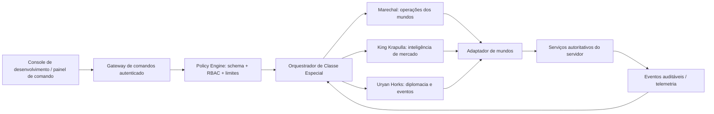

# Arquitetura dos Mundos e Agentes Especiais — Khaaos Run

> Documento de implementação para a camada de orquestração do console e a Classe Especial do Submundo KR. A lore e os parâmetros dos mundos permanecem subordinados ao cânone existente em [`fase4/WORLDS_DESIGN.md`](fase4/WORLDS_DESIGN.md), às configurações UE5 e aos dados validados pelo servidor.

## 1. Escopo e estado

Este material transforma a documentação existente em contratos de software, políticas de comando, algoritmos reproduzíveis e critérios de validação. A hierarquia de progressão dos jogadores (CIGKV → W1 → W2 → W3 → W4) não deve ser confundida com a hierarquia de comando dos agentes. Os agentes abaixo são NPCs/serviços de orquestração do universo ficcional; não são usuários com privilégios administrativos reais.

A primeira implementação é **determinística**. Ela não depende de provedor LLM, não cria rotas administrativas e não efetua mutações na economia, contas, inventário ou partidas. O servidor continua sendo a autoridade para autenticação, autorização, estado competitivo, persistência e transações. A integração futura deve usar adaptadores explícitos e políticas do lado do servidor.

## 2. Arquitetura lógica



### Componentes e responsabilidades

| Componente | Responsabilidade | Não pode fazer |
|---|---|---|
| Console | Submeter comandos declarativos e apresentar resultados | confiar em permissões calculadas no cliente |
| Gateway | autenticar ator, validar esquema, aplicar rate limit e gerar `requestId` | aceitar identidade/role vinda do payload como prova |
| Policy Engine | checar allowlist, escopo, estado e idempotência | conceder autoridade por nome de agente |
| Orquestrador | selecionar o agente competente, anexar contexto limitado e normalizar resposta | chamar diretamente banco/ledger ou executar texto arbitrário |
| Adaptadores | traduzir comandos aprovados para serviços internos tipados | aceitar SQL, shell, código ou URL arbitrária de agente |
| Event log | registrar request, decisão, ator, política e resultado | armazenar segredos, tokens ou dados pessoais desnecessários |

### Fluxo padrão de comando

1. Receber `requestId`, `actorId` da sessão autenticada, `command`, `scope`, `payload` e timestamp.
2. Validar estrutura, limites numéricos, enums e tamanho dos campos; rejeitar propriedades desconhecidas.
3. Verificar autorização do **ator humano/serviço autenticado**, não a alegação do agente.
4. Confirmar escopo de mundo e estado atual; verificar versão/`expectedRevision` em operações concorrentes.
5. Aplicar idempotência por `(actorId, requestId)` e limites por ator/ação.
6. Pedir ao agente uma recomendação tipada; validação de política pode transformar recomendação em rejeição.
7. Se for ação de escrita, produzir `proposal` que um serviço do jogo pode aprovar; nunca executar por texto livre.
8. Persistir trilha de auditoria e responder com `decision`, `reasonCodes`, `proposalId` opcional e `correlationId`.

## 3. Hierarquia da Classe Especial (Submundo KR)

```text
Autoridade real do sistema: servidor + permissões autenticadas
└── Classe Especial — Submundo KR (papéis de agente ficcionais)
    ├── Marechal — Henricks Hunterheads III (comando estratégico / operações)
    ├── Centralizador do Mercado Negro — King Krapulla (mercado / inteligência econômica)
    └── Embaixadora — Uryan Horks (diplomacia / relações entre facções)
```

A hierarquia é **funcional, não uma escalada de privilégios técnicos**. O Marechal coordena prioridades operacionais e resolve conflitos entre recomendações. King Krapulla mantém independência na análise do mercado, mas não pode movimentar KRC nem conceder itens. Uryan pode propor tratados, mensagens e eventos diplomáticos, mas não pode alterar alianças persistidas, contas ou acesso. Um parecer do Marechal tampouco suplanta o Policy Engine.

### Matriz de comando

| Agente | Missão | Entradas permitidas | Saídas tipadas | Escalonamento |
|---|---|---|---|---|
| **Marechal — Henricks Hunterheads III** | coordenar estado operacional dos mundos, alertas de ring, incidentes e recomendações de cadência | telemetria agregada, mundo/fase, saúde dos serviços, eventos de jogo | `WORLD_STATUS`, `OPERATIONAL_ALERT`, `WORLD_CHANGE_PROPOSAL` | risco competitivo, inconsistência de estado, proposta de escrita |
| **King Krapulla — Centralizador do Mercado Negro** | resumir oferta/procura, detectar anomalias e sugerir equilíbrio de mercado fictício | métricas agregadas de itens/mercado e catálogo publicado | `MARKET_BRIEF`, `PRICE_ADJUSTMENT_PROPOSAL`, `ANOMALY_ALERT` | economia real, saldo/ledger, suspeita de fraude ou alteração de preços em produção |
| **Uryan Horks — Embaixadora** | interpretar relações entre facções, preparar comunicados e propor eventos narrativos | relações de facções publicadas, eventos e conteúdo permitido | `DIPLOMATIC_BRIEF`, `MESSAGE_DRAFT`, `EVENT_PROPOSAL` | assédio/ameaça, comunicação pública, promessa/recompensa persistente ou escrita de aliança |

**Precedência quando as propostas colidem:** segurança e integridade do servidor → regras competitivas → disponibilidade do mundo → análise de mercado → diplomacia narrativa. O desempate é registrado pelo Policy Engine; não é inferido por personalidade ou prompt.

## 4. Arquitetura de mundos como dados

Cada mundo deve ser tratado como uma definição versionada, não como lógica duplicada por mapa. A especificação completa de setores, progressão, ameaças e configuração UE5 está em `docs/fase4/WORLDS_DESIGN.md` e `Unreal/KhaaosRun/Config/Default*.ini`.

### Contrato `WorldDefinition`

```ts
interface WorldDefinition {
  id: "CIGKV" | "W1" | "W2" | "W3" | "W4";
  name: string;
  mapKey: string;
  capacity: number;
  durationSeconds: number;
  zonePhases: number;
  extractionCount: number;
  entry: { previousWorld?: string; requiredMatches: number };
  mechanics: string[];
  configRevision: string;
}
```

Os parâmetros de balanceamento devem ser carregados de fonte única/versionada e validados antes de ativação. Nomes de mundo/valores publicados aqui são parâmetros documentais existentes, não prova de que todos os mapas estejam implementados ou ativos no serviço.

| Mundo | Nome | Capacidade documentada | Duração | Extrações (ZEX) | Progressão |
|---|---|---:|---:|---:|---|
| CIGKV | Khaaos Ville / campo de treino | 50 | 3 h | 15 | desbloqueado |
| W1/C1 | Barburhen | 100 | 5.400 s | 30 | 10 partidas CIGKV |
| W2/C2 | Priadus | 75 | 7.200 s | 20 | 5 partidas W1 |
| W3/C3 | Ckesalth | 60 | 5.400 s | 25 | 5 partidas W2 |
| W4/C4 | Arukheea | 80 | 6.000 s | 22 | 5 partidas W3 |

**Nota de reconciliação:** valores acima refletem `WORLDS_DESIGN.md`; trechos mais antigos de lore podem descrever diferentes capacidades, duração e mecânicas. Antes de promover a produção, nomear um registro canônico versionado e reconciliar ini, runtime, APIs e documentação. O agente não deve escolher silenciosamente entre valores conflitantes.

### Princípios e algoritmos

- **Progressão:** grafo dirigido acíclico com CIGKV como raiz. Para cada aresta, elegibilidade = partidas concluídas e válidas no mundo anterior ≥ requisito; o servidor valida o registro, nunca o cliente.
- **Alocação do ring:** seleção por `worldId + matchId + configRevision`; alocação atômica com capacidade reservada no servidor. Falha de alocação retorna `CAPACITY_REACHED`, sem degradar para outro mundo sem consentimento/regra explícita.
- **Zona segura:** fases como configuração imutável por partida. Transição calculada pelo relógio monotônico do servidor; todos os participantes recebem o mesmo `phase`, `startedAt`, centro e raio. Cliente apenas interpola visualmente.
- **Eventos ambientais:** agenda determinística por seed da partida; validar intervalo, duração, dano máximo e zonas permitidas. Não sortear com `Math.random()` independente em clientes.
- **ZEX/persistência:** checkpoint idempotente com `matchId + playerId + zexId`; validação de distância, estado vivo, cooldown e revisão do inventário no servidor. Um checkpoint registra progresso elegível; não garante pagamento ou saque.
- **Economia:** KRC atual é economia de jogo. Qualquer eventual valor real exige desenho e revisão separados (ledger append-only, transação atômica, idempotência, reconciliação, antifraude e compliance). Agentes não acessam gravações de saldo.
- **Observabilidade:** métricas agregadas de ocupação, latência de fase, extrações concluídas, abandono, taxa de eliminação ambiental e erros por revisão; minimizar e anonimizar dados pessoais.

## 5. Algoritmos de orquestração dos agentes

### Seleção do especialista

Uma tabela estática `command → agent → requiredScope → effect` determina qual agente pode responder. Comando sem mapeamento é recusado (`COMMAND_NOT_ALLOWED`). Não há fallback para outro agente que amplie a permissão.

### Prioridade de alertas

Para alertas não financeiros, usar prioridade explicável e limitada:

```text
severity = 0..4, impact = 0..4, confidence = 0..1, staleness = 0..1
score = round(25 * (0.45*severity + 0.35*impact + 0.20*4*confidence) * (1 - 0.5*staleness))
```

`score` varia 0–100; alertas com dados antigos são rebaixados, não escalados. Ordenar por score decrescente e `createdAt` crescente como desempate estável. O score organiza a fila, não autoriza ações.

### Política de efeito

- `read`: leitura de dados agregados e allowlisted.
- `proposal`: sugestão revisável sem mutação.
- `write`: somente endpoint interno explicitamente permitido, ator autorizado, validação do domínio, trilha de auditoria e checagem de revisão. Não disponível a estes três agentes na implementação inicial.
- `irreversible` / financeiro / publicação externa: recusado neste módulo e encaminhado a fluxo próprio de autorização humana.

### Conselho assíncrono da Classe Especial

`runSpecialClassCouncil()` executa duas rodadas paralelas por adapters injetados: (1) Marechal, King Krapulla e Uryan emitem pareceres iniciais; (2) cada agente recebe o próprio parecer e os dois pareceres pares, podendo revisar sua posição. Cada chamada tem deadline configurável (padrão 5 s; faixa permitida 50–60.000 ms). Exceção, timeout ou parecer inválido produz resultado `partial`, inclui posição conservadora `hold` para o agente ausente e exige revisão humana. Contexto inválido é rejeitado antes de invocar qualquer adapter.

Política de conflito no `resolveGovernanceConflicts()`:

1. **Segurança (500):** `hold` ou `oppose` veta a proposta (`safety-veto`).
2. **Integridade competitiva (400):** `hold` ou `oppose` veta a proposta (`integrity-veto`).
3. **Operações (300), economia (200), diplomacia (100):** divergência permite selecionar uma recomendação superior apenas como `preferred-proposal`; empate no nível de maior precedência ou conflito puramente diplomático escala para pessoa (`escalated-human-review`).
4. A precedência não pode ser alterada por confiança, ordem de chegada ou cargo ficcional. Competência por agente é verificada: Marechal (segurança/integridade/operações), King (economia), Uryan (diplomacia).
5. Todos os resultados carregam `executable: false`; não há escrita nem resolução automática de saldo, partida, aliança ou publicação. Falhas e casos parciais sempre falham fechados.

Contrato HTTP planejado e exemplos de payload do painel: [`API_MARECHAL_CONTROL_PANEL.md`](API_MARECHAL_CONTROL_PANEL.md). Rotas ainda não estão implementadas.

### Defesa contra abuso e falhas

- Allowlist fechada de comandos e schema estrito; texto narrativo não é executável.
- Sem ferramentas genéricas (`shell`, SQL, HTTP arbitrário, escrita de arquivo, navegador ou execução de código).
- Timeout, limite de tamanho, circuit breaker e resultados degradados claramente marcados como stale.
- Deduplicação por request id; não repetir mutações após timeout incerto.
- Registros estruturados sem segredos; `reasonCodes` estáveis para teste e auditoria.
- Contexto mínimo e agregado; nunca enviar sessão, token, e-mail, endereço ou conversa privada do jogador.

## 6. Interface de comando proposta

Exemplos declarativos para documentação/test harness — não habilitam comandos no console de produção:

```text
kr.agent.status --world W1
kr.agent.marshal.propose-world-window --world W2 --window 15m
kr.agent.market.brief --world W3 --period 24h
kr.agent.ambassador.draft --faction "Vigias do Porto" --topic trégua
```

Em produção, implementar como API tipada (ex.: `POST /api/console/agents/commands`) atrás da autenticação e autorização já adotadas no servidor. Nunca aceitar uma linha de shell e interpretá-la como comando.

Exemplo de envelope:

```json
{
  "requestId": "uuid-v4",
  "command": "market.brief",
  "scope": { "worldId": "W3", "periodSeconds": 86400 },
  "payload": {},
  "expectedRevision": "market-config-17"
}
```

Resposta padrão: `{ "status": "ok|rejected|proposal", "agentId": "king-krapulla", "summary": "...", "reasonCodes": [], "proposalId": null, "correlationId": "...", "dataRevision": "..." }`.

## 7. Implementação no repositório

- `server/game/orchestration.ts`: agentes, allowlist, validação, escore e recomendações puros/determinísticos.
- `tests/official/orchestration.test.ts`: testes de roteamento, escopo, bloqueio de escrita, ranking e payloads inválidos.
- `tests/official/orchestration.integration.test.ts`: comunicação assíncrona em duas rodadas, falha parcial, vetos e empate escalado.
- `docs/fase4/WORLDS_DESIGN.md`: cânone atual dos mundos.
- `Unreal/KhaaosRun/Config/Default*.ini`: configuração da camada UE5; alinhar usando `configRevision` no futuro.

Próxima etapa para serviço real: definir DTOs compartilhados em `shared/`, ligar rotas somente leitura autenticadas, coletar telemetria agregada e criar um adaptador de aprovação de propostas. Isso deve ser feito após validar a matriz de permissões, estados de mundo e revisão canônica dos parâmetros conflitantes.

## 8. Critérios de aceite

1. Cada comando conhecido roteia para um único agente especialista.
2. Comandos desconhecidos, escopo inválido ou payload acima do limite são rejeitados com código estável.
3. Nenhum agente produz efeito de escrita, financeiro ou externo; apenas leitura agregada ou proposta tipada.
4. Pontuação e ordenação são determinísticas para os mesmos dados.
5. Casos de retry não duplicam propostas quando o mesmo request id é utilizado no adaptador.
6. Conselho consulta os três agentes paralelamente, compartilha pareceres na revisão, aplica deadline e falha fechado.
7. Vetos de segurança/integridade, limites de competência e escalação humana são determinísticos; nenhuma decisão é executável.
8. TypeScript compila e testes unitários/de integração passam sem alterar configurações locais da Unreal.
